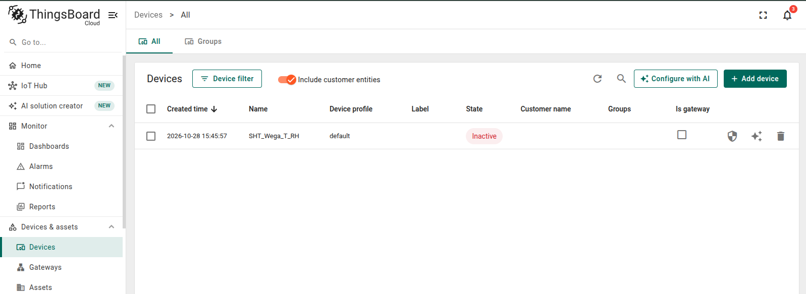
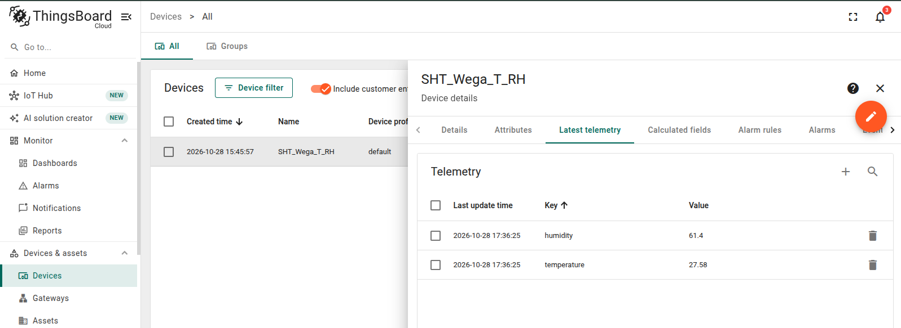
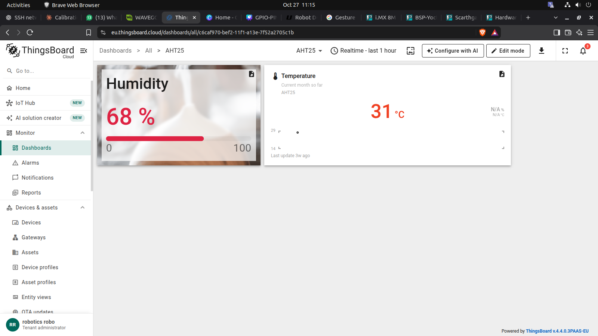

.. START:section:0:0
Overview
========

.. END:section:0:0

.. START:main_content:0:0
ThingsBoard Cloud is an IoT platform used to connect devices, collect telemetry data, monitor sensor measurements, and visualize information through dashboards. It supports communication protocols such as HTTP and MQTT, allowing embedded Linux devices and sensor applications to send data to the cloud.

This document explains how to configure ThingsBoard Cloud, register a device, obtain authentication credentials, test connectivity, submit telemetry, and verify the received data.

Official References:

.. END:main_content:0:0

| ThingsBoard Cloud: https://thingsboard.cloud/
| ThingsBoard Cloud Documentation: https://thingsboard.io/docs/paas/
| Getting Started with ThingsBoard Cloud: https://thingsboard.io/docs/paas/getting-started/

.. START:section:0:1
Objective
=========

.. END:section:0:1

.. START:main_content:0:1
The objective is to prepare ThingsBoard Cloud to receive telemetry from an embedded device.

The configuration process includes:

.. END:main_content:0:1

.. START:list:0:1:0

.. LIST_META: {"type": "bullet", "head": "", "items": ["Accessing the ThingsBoard Cloud platform.", "Creating and configuring a device.", "Obtaining device authentication credentials.", "Verifying network connectivity.", "Testing telemetry submission through HTTP.", "Validating received data in the platform.", "Preparing the device for dashboard integration"]}

- Accessing the ThingsBoard Cloud platform.
- Creating and configuring a device.
- Obtaining device authentication credentials.
- Verifying network connectivity.
- Testing telemetry submission through HTTP.
- Validating received data in the platform.
- Preparing the device for dashboard integration

.. END:list:0:1:0

Reference: https://thingsboard.io/docs/paas/getting-started/

.. START:section:0:2
Prerequisites
=============

.. END:section:0:2

.. START:main_content:0:2
Before beginning the configuration, ensure that the following requirements are satisfied.

.. END:main_content:0:2

Hardware Requirements
---------------------

.. START:list:0:2:1

.. LIST_META: {"type": "bullet", "head": "", "items": ["Embedded Linux development board or computer.", "Sensor connected to the target board, if actual sensor measurements are required.", "Network connection with internet acces"]}

- Embedded Linux development board or computer.
- Sensor connected to the target board, if actual sensor measurements are required.
- Network connection with internet acces

.. END:list:0:2:1

Software Requirements

.. START:list:0:2:3

.. LIST_META: {"type": "bullet", "head": "", "items": ["Web browser.", "Python 3, if the sensor application uses Python.", "curl command-line utility for HTTP testing.", "ThingsBoard Cloud account."]}

- Web browser.
- Python 3, if the sensor application uses Python.
- curl command-line utility for HTTP testing.
- ThingsBoard Cloud account.

.. END:list:0:2:3

Network Requirements

.. START:list:0:2:5

.. LIST_META: {"type": "bullet", "head": "", "items": ["Access to the internet.", "DNS resolution for the ThingsBoard Cloud hostname.", "Outbound HTTPS connectivity on TCP port 443."]}

- Access to the internet.
- DNS resolution for the ThingsBoard Cloud hostname.
- Outbound HTTPS connectivity on TCP port 443.

.. END:list:0:2:5

Official References:

.. START:list:0:2:7

.. LIST_META: {"type": "bullet", "head": "", "items": ["ThingsBoard Cloud Getting Started: https://thingsboard.io/docs/paas/getting-started/", "HTTP Connection Requirements: https://thingsboard.io/docs/paas/eu/reference/http-api/getting-connected/"]}

- ThingsBoard Cloud Getting Started: https://thingsboard.io/docs/paas/getting-started/
- HTTP Connection Requirements: https://thingsboard.io/docs/paas/eu/reference/http-api/getting-connected/

.. END:list:0:2:7

.. START:section:0:3
Access ThingsBoard Cloud
========================

.. END:section:0:3

.. START:list:0:3:0

.. LIST_META: {"type": "auto", "head": "", "items": ["Open the ThingsBoard Cloud website.", "Sign in using the configured account credentials.", "Confirm that the platform interface loads successfully.", "Navigate to the device management section."]}

1. Open the ThingsBoard Cloud website.
2. Sign in using the configured account credentials.
3. Confirm that the platform interface loads successfully.
4. Navigate to the device management section.

.. END:list:0:3:0

| ThingsBoard Cloud is hosted remotely, so a local ThingsBoard server installation is not required.
| The platform provides device management, telemetry storage, dashboard visualization, and other IoT application features.

Official References:

.. START:list:0:3:2

.. LIST_META: {"type": "bullet", "head": "", "items": ["ThingsBoard Cloud Platform: https://thingsboard.cloud/", "Cloud Getting Started Guide: https://thingsboard.io/docs/paas/getting-started/"]}

-     ThingsBoard Cloud Platform: https://thingsboard.cloud/
-     Cloud Getting Started Guide: https://thingsboard.io/docs/paas/getting-started/

.. END:list:0:3:2

.. START:section:0:4
Create and Configure a Device
=============================

.. END:section:0:4

.. START:main_content:0:4
A device represents the physical hardware or software application that sends telemetry to ThingsBoard.

For example, a device can represent an embedded Linux board collecting temperature and humidity measurements.

.. END:main_content:0:4

Device Creation Procedure
-------------------------

.. START:list:0:4:1

.. LIST_META: {"type": "auto", "head": "", "items": ["Navigate to Devices & assets → Devices.", "Select Add device.", "Choose the option to add a new device.", "Enter a unique device name, such as ES1351X_Sensor_Device.", "Select an appropriate device profile if required.", "Configure the ownership and grouping options if applicable.", "Save the device configuration."]}

1. Navigate to Devices & assets → Devices.
2. Select Add device.
3. Choose the option to add a new device.
4. Enter a unique device name, such as ES1351X_Sensor_Device.
5. Select an appropriate device profile if required.
6. Configure the ownership and grouping options if applicable.
7. Save the device configuration.

.. END:list:0:4:1

After creation, open the device details and verify that the device appears in the device list.

.. START:image:0:4:3

.. END:image:0:4:3

|

Device Configuration Details
----------------------------

.. START:table:0:4:5

.. csv-table::
   :header: "Parameter", "Description"
   :widths: 25, 75
   :align: center

   "Device Name", "Identifies the device in ThingsBoard Cloud."
   "Device Profile", "Defines the device's applicable configuration and behavior."
   "Device ID", "Unique identifier assigned to the device by the platform."
   "Device Credentials", "Authentication information used to connect the device."
   "Telemetry Keys", "Names used to identify the reported measurements, such as ``temperature`` and ``humidity``."

.. END:table:0:4:5

Official Reference: https://thingsboard.io/docs/paas/user-guide/devices/

Obtain Device Authentication Credentials
----------------------------------------

Device credentials authenticate the device when it sends telemetry to ThingsBoard Cloud.

For HTTP telemetry, the device can use an access token.

Procedure
---------

.. START:list:0:4:9

.. LIST_META: {"type": "bullet", "head": "", "items": ["Open the created device.", "Select the device credentials or Manage credentials option.", "Confirm that the credential type is appropriate for HTTP communication.", "Copy the device access token.", "Store the token securely for use by the application."]}

- Open the created device.
- Select the device credentials or Manage credentials option.
- Confirm that the credential type is appropriate for HTTP communication.
- Copy the device access token.
- Store the token securely for use by the application.

.. END:list:0:4:9

The access token is included in the HTTP telemetry endpoint to identify and authenticate the device.

Security Requirements
---------------------

.. START:list:0:4:12

.. LIST_META: {"type": "bullet", "head": "", "items": ["Do not publish access tokens in public documents or repositories.", "Avoid hardcoding production credentials directly into application source code.", "Store credentials in a protected configuration file or environment variable.", "Replace exposed credentials if they are accidentally shared."]}

- Do not publish access tokens in public documents or repositories.
- Avoid hardcoding production credentials directly into application source code.
- Store credentials in a protected configuration file or environment variable.
- Replace exposed credentials if they are accidentally shared.

.. END:list:0:4:12

Official References:

.. START:list:0:4:14

.. LIST_META: {"type": "bullet", "head": "", "items": ["Device Management and Credentials: https://thingsboard.io/docs/paas/user-guide/devices/", "HTTP Authentication and Connection Details: https://thingsboard.io/docs/paas/eu/reference/http-api/getting-connected/"]}

- Device Management and Credentials: https://thingsboard.io/docs/paas/user-guide/devices/
- HTTP Authentication and Connection Details: https://thingsboard.io/docs/paas/eu/reference/http-api/getting-connected/

.. END:list:0:4:14

.. START:section:0:5
Prerequisites for HTTP Telemetry Testing
========================================

.. END:section:0:5

.. START:main_content:0:5
To test device communication with ThingsBoard Cloud, a computer with an internet connection and the curl command-line utility is required. No physical sensor board or local ThingsBoard installation is needed.

.. END:main_content:0:5

Check curl Installation
-----------------------

Open the Ubuntu terminal and execute:

.. START:code:0:5:1

.. code-block:: console

   curl --version

.. END:code:0:5:1

If curl is not installed, install it using:

.. START:code:0:5:3

.. code-block:: console

   sudo apt update
   sudo apt install curl -y

.. END:code:0:5:3

After installation, verify the version using curl --version.

.. START:section:0:6
Test Device Telemetry Using HTTP
================================

.. END:section:0:6

Obtain Device Access Token
--------------------------

Keep the Access Token private.

.. START:list:0:6:1

.. LIST_META: {"type": "auto", "head": "", "items": ["Log in to ThingsBoard Cloud.", "Navigate to Devices & assets → Devices.", "Open the device created earlier.", "Select Manage credentials.", "Copy the device's Access Token."]}

1. Log in to ThingsBoard Cloud.
2. Navigate to Devices & assets → Devices.
3. Open the device created earlier.
4. Select Manage credentials.
5. Copy the device's Access Token.

.. END:list:0:6:1

Send Test Telemetry
-------------------

Execute the following command in the Ubuntu terminal. Replace YOUR_DEVICE_ACCESS_TOKEN with the actual device Access Token.

.. START:code:0:6:4

.. code-block:: console

   curl -v -X POST \
     "https://thingsboard.cloud/api/v1/YOUR_DEVICE_ACCESS_TOKEN/telemetry" \
     -H "Content-Type: application/json" \
     -d '{"temperature":28.5,"humidity":62}'

.. END:code:0:6:4

This request sends sample temperature and humidity values to ThingsBoard Cloud using HTTP.

**Expected result:** The server commonly returns HTTP status 200 when the request is successful.

Verify Received Telemetry
-------------------------

.. START:list:0:6:7

.. LIST_META: {"type": "bullet", "head": "", "items": ["Open ThingsBoard Cloud.", "Navigate to Devices → Demo_Device_01.", "Open the Latest telemetry section", "Verify that the following values are displayed:"]}

- Open ThingsBoard Cloud.
- Navigate to Devices → Demo_Device_01.
- Open the Latest telemetry section
- Verify that the following values are displayed:

.. END:list:0:6:7

.. START:image:0:6:8

.. END:image:0:6:8

|

If the values appear, the HTTP telemetry test is successful.

Reference: ThingsBoard HTTP Telemetry API

.. START:section:0:7
Create a Dashboard
==================

.. END:section:0:7

.. START:main_content:0:7
A dashboard provides a visual representation of device telemetry, allowing users to monitor temperature, humidity, and other data through widgets.

.. END:main_content:0:7

 Create a New Dashboard
-----------------------

.. START:list:0:7:1

.. LIST_META: {"type": "auto", "head": "", "items": ["Log in to ThingsBoard Cloud.", "Navigate to Dashboards.", "Click + Add dashboard.", "Enter the dashboard name, for example, Demo_Device_Dashboard.", "Click Add to create the dashboard."]}

1. Log in to ThingsBoard Cloud.
2. Navigate to Dashboards.
3. Click + Add dashboard.
4. Enter the dashboard name, for example, Demo_Device_Dashboard.
5. Click Add to create the dashboard.

.. END:list:0:7:1

Add Telemetry Widgets
---------------------

.. START:list:0:7:3

.. LIST_META: {"type": "auto", "head": "", "items": ["Open the newly created dashboard.", "Enter edit mode and select Add widget.", "Choose a suitable widget, such as a digital gauge, card, or time-series chart.", "Configure the widget data source by selecting the device Demo_Device_01.", "Select the telemetry key, such as temperature or humidity.", "Save the widget configuration.", "Save the dashboard."]}

1. Open the newly created dashboard.
2. Enter edit mode and select Add widget.
3. Choose a suitable widget, such as a digital gauge, card, or time-series chart.
4. Configure the widget data source by selecting the device Demo_Device_01.
5. Select the telemetry key, such as temperature or humidity.
6. Save the widget configuration.
7. Save the dashboard.

.. END:list:0:7:3

Repeat these steps to display additional telemetry values.

Verify Dashboard Data
---------------------

Open the dashboard and confirm that the widgets display the telemetry values received from the device.

For example:

.. START:image:0:7:10

.. END:image:0:7:10

|

The displayed values depend on the telemetry data received by ThingsBoard Cloud.

.. START:section:0:8
Testing and Validation
======================

.. END:section:0:8

.. START:main_content:0:8
Verify the following items before completing the configuration:

.. END:main_content:0:8

.. START:list:0:8:0

.. LIST_META: {"type": "bullet", "head": "", "items": ["The device is successfully created in ThingsBoard Cloud.", "The device Access Token is available.", "HTTP telemetry requests are successful.", "Telemetry values appear under Latest telemetry.", "Dashboard widgets display the expected values"]}

- The device is successfully created in ThingsBoard Cloud.
- The device Access Token is available.
- HTTP telemetry requests are successful.
- Telemetry values appear under Latest telemetry.
- Dashboard widgets display the expected values

.. END:list:0:8:0

.. START:section:0:9
Conclusion
==========

.. END:section:0:9

.. START:main_content:0:9
ThingsBoard Cloud allows users to create devices, receive telemetry through HTTP, and visualize device data using dashboards. These steps demonstrate the basic configuration and data-monitoring workflow without requiring physical sensor hardware or a local ThingsBoard server.

.. END:main_content:0:9
